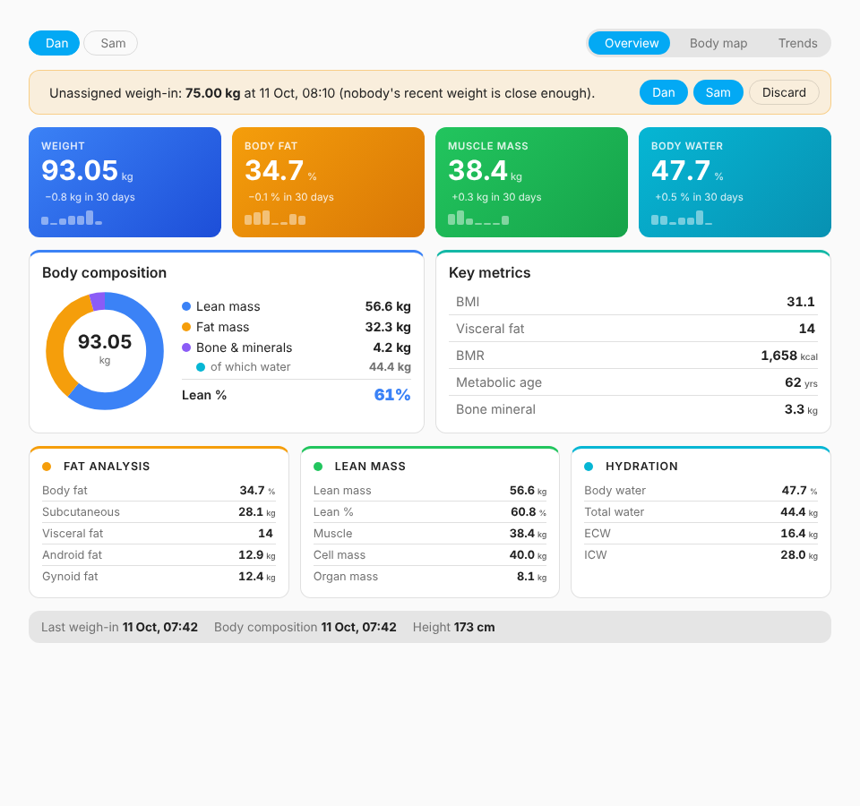
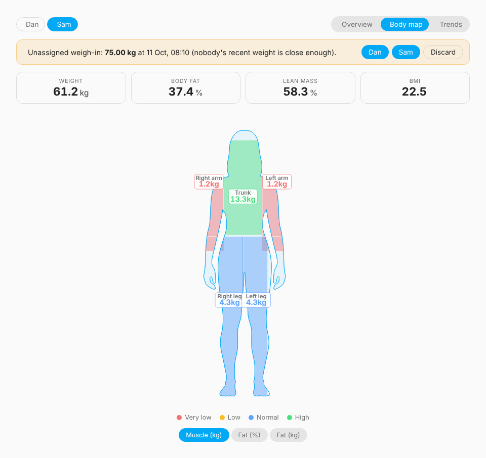
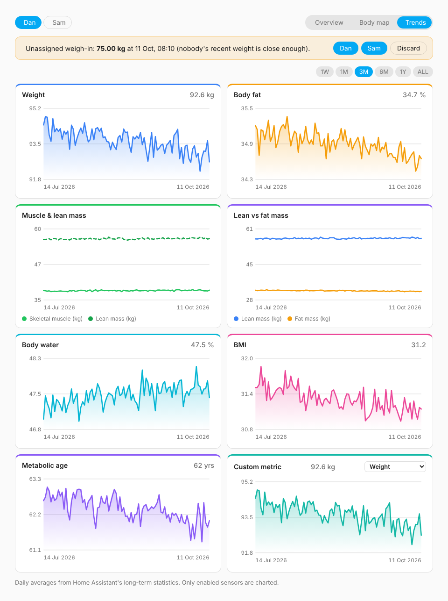

# Hume Body Pod for Home Assistant

[](https://github.com/danfulton72/hume_pod_ha/actions/workflows/validate.yml)
[](https://github.com/danfulton72/hume_pod_ha/actions/workflows/tests.yml)

A local, cloud-free Home Assistant integration for the **Hume Health Body Pod** smart scale. It talks to the scale over Bluetooth (any HA Bluetooth adapter or ESPHome Bluetooth proxy), so weigh-ins need no Hume account or phone. Several people can share one scale: each weigh-in is matched to the right person automatically by weight and body fat.

Protocol and body-composition maths are based on [Blue2Scale](https://github.com/JozefJarosciak/Blue2Scale.com) by Jozef Jarosciak, ported from JavaScript to Python.

## How it works

1. The Body Pod sleeps until you tap or step on it, then advertises over BLE for ~30 seconds.
2. Home Assistant sees the advertisement, connects, and starts a measurement.
3. The scale streams weight packets until the weight locks. **Stay on, barefoot, for another ~15 s**: the scale then measures segmental impedance at ~50 kHz and ~250 kHz. The Status sensor and the dashboard card show *Analysing body composition* during this stage; step off once it finishes.
4. The integration works out who it was (see below), computes 39 body-composition metrics with that person's profile, and updates their sensors.

Weigh-ins with socks on (or stepping off early) still record **weight** and **BMI**; body-composition sensors keep their previous values.

## Installation

**HACS:** HACS → ⋮ → Custom repositories → add `https://github.com/danfulton72/hume_pod_ha` as type *Integration* → install **Hume Body Pod** → restart Home Assistant.

**Manual:** copy `custom_components/hume_pod` into your `config/custom_components/` folder and restart.

Requires Home Assistant 2025.6 or newer with Bluetooth working, and the scale in range of an adapter or [ESPHome Bluetooth proxy](https://esphome.io/components/bluetooth_proxy.html) that supports active connections (`bluetooth_proxy: active: true`). A passive-only proxy can see the scale but can't talk to it. The integration's own icon shows in HA 2026.3 and later.

## Setup

Tap the scale to wake it. HA should show a *Discovered: Body Pod* card; otherwise go to **Settings → Devices & services → Add integration → Hume Body Pod**. Setup asks for the first person's details.

To add more people, open the integration and choose **Add person**. To change someone's height, date of birth and so on, use the ⋮ menu next to their name → **Reconfigure**. Age is recalculated from date of birth at every weigh-in.

Giving each person an **approximate weight** when you add them lets the very first weigh-ins be matched straight away.

## Who stepped on? Automatic matching

For every weigh-in the integration compares the reading with each person's previous weigh-in:

- **Weight**: a person is only considered if the reading is within the *weight tolerance* (default 3 kg) of their last weight.
- **Body fat**: when the reading includes impedance, body fat is calculated with *each candidate's own profile* and compared with their last body fat, scaled by the *body fat tolerance* (default 4 percentage points). This separates people of similar weight.
- The closest person wins. If two people are too close to call, or nobody is within tolerance (a guest, or a big change after a holiday), the reading is kept as an **unassigned weigh-in** instead of polluting anyone's history.
- An **approximate weight** entered at setup is treated as a rough guess: it gets three times the weight tolerance until that person's first real weigh-in.
- If only one person is set up and they haven't weighed in yet, the weigh-in goes to them whatever their approximate weight. Likewise, if someone has no history or estimate and nobody else matches, it goes to them.

Adjust both tolerances under the integration's **Configure** button.

### Unassigned weigh-ins

The scale device has an **Unassigned weigh-in** sensor showing the weight, with attributes explaining why it wasn't matched. Resolve it with:

- `hume_pod.assign_weigh_in`: pick the person's device; the weigh-in is recorded for them, with body composition calculated from their profile.
- `hume_pod.discard_weigh_in`: pick the scale device to throw it away.

An actionable phone notification is a convenient way to do this:

```yaml
automation:
  - alias: Body Pod - who was that?
    triggers:
      - trigger: state
        entity_id: sensor.body_pod_unassigned_weigh_in
        not_to: [unknown, unavailable]
    actions:
      - action: notify.mobile_app_phone
        data:
          message: "Unassigned weigh-in: {{ trigger.to_state.state }} kg"
          data:
            actions:
              - action: HUME_ASSIGN_DAN
                title: Dan
              - action: HUME_ASSIGN_SAM
                title: Sam
              - action: HUME_DISCARD
                title: Discard

  - alias: Body Pod - handle answer
    triggers:
      - trigger: event
        event_type: mobile_app_notification_action
        event_data: { action: HUME_ASSIGN_DAN }
        id: dan
      - trigger: event
        event_type: mobile_app_notification_action
        event_data: { action: HUME_ASSIGN_SAM }
        id: sam
      - trigger: event
        event_type: mobile_app_notification_action
        event_data: { action: HUME_DISCARD }
        id: discard
    actions:
      - choose:
          - conditions: "{{ trigger.id == 'discard' }}"
            sequence:
              - action: hume_pod.discard_weigh_in
                data:
                  scale: "{{ device_id('sensor.body_pod_status') }}"
        default:
          - action: hume_pod.assign_weigh_in
            data:
              person: "{{ device_id('sensor.' ~ trigger.id ~ '_weight') }}"
```

## Dashboard

The integration ships a **Hume Body Pod card**, modelled on the [Blue2Scale](https://github.com/JozefJarosciak/Blue2Scale.com) web app. It loads automatically: there's no dashboard resource to add.

| Overview | Body map | Trends |
| --- | --- | --- |
|  |  |  |

<sub>Screenshots rendered with sample data.</sub>

- **Overview:** weight, body fat, muscle and water with 30-day change and sparklines; a body-composition donut; key metrics (BMI, visceral fat, BMR, metabolic age, bone mineral); fat, lean and hydration breakdowns.
- **Body map:** male or female silhouette coloured by segment, switchable between muscle, fat % and fat mass, using Blue2Scale's ratings.
- **Trends:** charts for weight, body fat, muscle and lean mass, lean vs fat, body water, BMI and metabolic age, plus any metric you pick, over 1W/1M/3M/6M/1Y/ALL, from Home Assistant's long-term statistics. Hover or tap for values.
- Person switcher, a live "Measuring…" banner while someone is on the scale, and buttons to assign or discard an unassigned weigh-in.
- Follows your HA theme (light/dark) and unit system (kg/lb). Tap a value for its history.

**Ready-made dashboard:** create a new dashboard (Settings → Dashboards → Add dashboard → New dashboard from scratch), open it, choose Edit → ⋮ → Raw configuration editor, and paste [`dashboards/body_pod.yaml`](dashboards/body_pod.yaml). It has Overview, Body map and Trends pages plus scale status tiles.

**Single card:** add a card and pick *Hume Body Pod* from the list, or:

```yaml
type: custom:hume-pod-card
person: <person device>   # optional: omit to switch between everyone
view: overview            # overview | body | trends
show_tabs: true
```

The card shows every metric, even sensors that are disabled by default. Only *trend charts* need the sensor enabled, because they come from recorded statistics.

## Entities

**Scale device (`Body Pod`)**: status, unassigned weigh-in, last weigh-in, battery, signal strength, and live weight (disabled by default). The device page also shows the scale's model, firmware and hardware version once it has connected.

**One device per person**, linked to the scale:

- Enabled by default: weight, BMI, body fat %, fat mass, visceral fat, lean mass, skeletal muscle mass, body water %, bone mineral, BMR, metabolic age and last measured.
- Disabled by default: subcutaneous fat, android/gynoid fat and ratio, body cell mass, total/extra/intracellular water, mineral, skeletal and organ mass, segmental muscle and fat for each arm, leg and trunk, and the 10 raw impedance readings (diagnostic).

Each person's latest results are stored and survive restarts. Metric sensors use `state_class: measurement` for long-term statistics, and weights follow your HA unit system.

### Event

Every weigh-in fires `hume_pod_measurement`, including the matched `person` (or `null` if unassigned), `match_reason` (`matched`, `only_new_person`, `no_match`, `ambiguous`, `manual`), `match_distances`, all metric values and raw impedances.

## Limitations

- **Estimates, not clinical values.** The scale reports only weight and impedance; everything else comes from published BIA regression equations that Blue2Scale's author calibrated against the Hume app.
- **Discovery.** Scales are recognised by the name `Body Pod*`/`Hume*`, or, for units like the Body Pod 2 that advertise no name, by the `FFF0` service plus manufacturer data that starts with the scale's own Bluetooth address. If yours still isn't found, open an issue with a screenshot of its entry in **Settings → Bluetooth → Advertisement monitor**.
- The scale itself is always sent the first person's profile to start a measurement. This only affects the scale's own display; HA calculates results with the matched person's profile.
- After a weigh-in the integration ignores the scale for 45 seconds so it doesn't reconnect while the scale is still awake.

## Troubleshooting

The scale's device page shows a **Status** sensor (with `last_error`, `last_attempt` and `via` attributes) and a **Signal strength** sensor. Problems are also written to the log as warnings.

| What you see | What it means |
| --- | --- |
| `couldn't connect (RSSI -9x dBm via …)` | The proxy heard the scale but couldn't hold a connection. Below about -85 dBm this is common: move the proxy closer or add one near the scale. ESPHome proxies need `bluetooth_proxy: active: true`. |
| `connected, but the scale sent no data` | The connection worked but no readings arrived. Step on within a few seconds of waking the scale. If it keeps happening, please open an issue with a debug log. |
| `unexpected Bluetooth layout, missing …` | Your scale uses a different protocol from the one this integration knows. Please open an issue and include the message: it lists what the scale offers. |
| `no weight over 5 kg` | The scale connected and talked, but nobody was on it before it went quiet. |

For a debug log, use **Enable debug logging** on the integration page, tap the scale, weigh in, then **Disable debug logging** to download the log. It records each step: connection, the scale's services, every packet and the advertisement payload. Or add to `configuration.yaml`:

```yaml
logger:
  logs:
    custom_components.hume_pod: debug
```

Diagnostics (from the integration's ⋮ menu) include the same connection details, with names, birthdates and the Bluetooth address redacted.

## Development

```bash
python -m venv .venv && . .venv/bin/activate
pip install -r requirements_test.txt ruff
ruff check . && ruff format --check .
pytest
```

CI runs hassfest, HACS validation, ruff and the test suite on every push.

## Licence

The protocol details and BIA equations are derived from Blue2Scale, which is published under the **Blue2Scale Source-Available License 1.0** (see [BLUE2SCALE_LICENSE](BLUE2SCALE_LICENSE) and [NOTICE](NOTICE)). That licence allows forks and modifications for **non-production (personal, non-commercial) use** only. This project is for personal home use on that basis; ask the Blue2Scale author before using it commercially or submitting it to the default HACS store.
